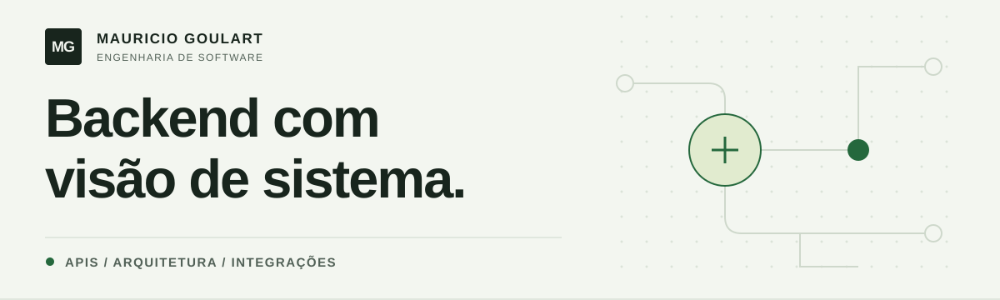

<picture>
  <source media="(prefers-color-scheme: dark)" srcset="./assets/profile/banner-dark.svg">
  <source media="(prefers-color-scheme: light)" srcset="./assets/profile/banner-light.svg">
  
</picture>

# Mauricio Goulart

**Engenharia de software · Backend, arquitetura e integrações**

Meu foco é construir APIs e conectar sistemas. Compartilho aqui implementações e estudos sobre organização de código, modelagem de domínio, persistência e comunicação entre serviços.

## Projetos para explorar

### [SocializeMe API](https://github.com/MauricioGoulartt/socializeme-api)

Domínio, casos de uso e persistência em uma API social.  
TypeScript · Express · MongoDB

### [SmartRanking](https://github.com/MauricioGoulartt/smartranking-api)

Jogadores, categorias e desafios organizados em módulos, com DTOs e validação.  
TypeScript · NestJS · Mongoose

### [Mensageria com RabbitMQ](https://github.com/MauricioGoulartt/microservices-RabbitMQ)

O caminho de uma mensagem: requisição HTTP, fila e consumidor.  
Node.js · RabbitMQ · Docker Compose

### [API com testes HTTP](https://github.com/MauricioGoulartt/tdd-clean-api)

Rotas de usuários, serviços e testes de comportamento com mocks.  
TypeScript · Express · Jest · Supertest

Cada README apresenta o escopo, o mapa do código e as limitações do projeto. São estudos públicos; a presença de código ou testes não equivale a prontidão para produção.

## Foco técnico

- **APIs e domínio:** contratos, validação e separação de responsabilidades.
- **Integrações e mensageria:** comunicação entre serviços e fluxos assíncronos.
- **Qualidade de código:** testes HTTP, organização em camadas e documentação do comportamento.

## Vamos trocar conhecimento

Encontrou uma melhoria ou quer discutir uma decisão de implementação? Abra uma issue no projeto correspondente, com contexto e um exemplo. Contribuições por pull request são bem-vindas.

[Explorar todos os repositórios](https://github.com/MauricioGoulartt?tab=repositories) · [Propor uma conversa técnica](https://github.com/MauricioGoulartt/MauricioGoulartt/issues/new)
